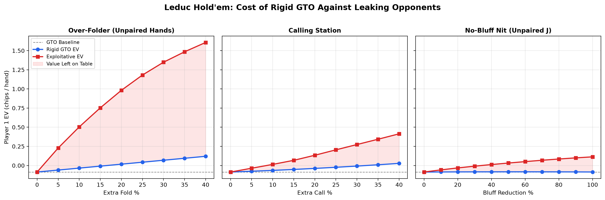

# ♠️ Game Theory Optimal (GTO) Poker Solver & Exploitative Lab

[](https://pokersolver.streamlit.app)

An imperfect-information game-theory solver built from scratch in Python and NumPy using **Counterfactual Regret Minimization (CFR / CFR+)**, paired with an exact information-constrained Best-Response evaluator and an interactive **Streamlit** decision-science dashboard.

> **Why Poker?** Imperfect-information games model the exact mathematical core of **competitive pricing, sealed-bid auctions, negotiation, and adversarial optimization**—making optimal decisions when you cannot observe your opponent's private information.

---

## Key Results & Benchmarks

| Game | Information Sets | Exact Nash EV (P1) | Solver EV | Exploitability | Key Algorithmic Milestone |
| :--- | :---: | :---: | :---: | :---: | :--- |
| **Kuhn Poker** | 12 | `-0.05556` (`-1/18`) | `-0.05556` | `< 0.0001` | **74× faster convergence** (CFR+ vs. Vanilla CFR at 1,000 iterations) |
| **Leduc Hold'em** | 288 | `-0.08561` | `-0.08561` | `0.00003` | Full 2-round, 6-card solver validated via exact Best-Response |

---

## Decision-Science Finding: The Cost of Rigid GTO

A Nash Equilibrium (GTO) is a **defensive shield**: it guarantees that no opponent—not even a mathematically perfect, information-constrained Nemesis—can exploit you. However, against predictable human leaks, sticking rigidly to GTO leaves substantial value on the table.

Using the converged 288-infoset Leduc Hold'em baseline, we injected three realistic opponent leaks into Player 2 while holding Player 1 at rigid GTO, then compared **Rigid GTO EV** against **Maximally Exploitative EV**:



| Opponent Leak Profile (Player 2) | Rigid GTO EV | Exploitative EV | Value Left on Table |
| :--- | :---: | :---: | :---: |
| **GTO Baseline** (0% leak) | `-0.08561` | `-0.08559` | `+0.00002` |
| **Over-Folder — Unpaired Hands** (+15% fold) | `-0.00852` | `+0.75333` | **`+0.76185`** |
| **Over-Folder — Unpaired Hands** (+30% fold) | `+0.06857` | `+1.34866` | **`+1.28009`** |
| **Calling Station** (+30% call) | `-0.00767` | `+0.27352` | **`+0.28119`** |
| **No-Bluff Nit** (-100% unpaired Jack bluffs) | `-0.08484` | `+0.11288` | **`+0.19772`** |

### Core Takeaway: The "No-Bluff Nit" Paradox
When Player 2 stops bluffing 100% of the time, **rigid GTO captures virtually zero incremental EV** (`-0.08561` → `-0.08484`). Because equilibrium strategies are constructed to make opponents indifferent between bluffing and checking, a rigid GTO agent keeps paying off non-existent bluffs. Capturing that `+0.20` chips/hand requires abandoning equilibrium and shifting to an exploitative counter-strategy.

---

## Interactive Streamlit App

Launch the web app to explore the solver interactively across three tabs:
1. **📊 Exploitative "What-If" Lab:** Drag leak-severity sliders to watch Rigid GTO EV vs. Maximally Exploitative EV update in real time on interactive Plotly curves.
2. **🧠 288-Infoset Strategy Explorer:** Inspect the exact Nash Equilibrium mixed strategies (Fold / Check-Call / Bet-Raise) for Jack, Queen, and King across any Round 1 or Round 2 betting sequence.
3. **🃏 Play vs. GTO Bot:** Play live hands against the converged Leduc GTO bot with a full post-hand reveal of the bot's hidden card and exact mixed-strategy probabilities.

---

## Algorithmic Architecture

* **Counterfactual Regret Minimization (CFR):** Tracks counterfactual regrets weighted by chance and opponent reach probabilities (`chance_prob × opponent_reach`), updating current strategies via Regret Matching while averaging historical strategies weighted by self-reach (`my_reach`).
* **CFR+ Upgrades:**
  * **Negative Regret Flooring:** Clamps cumulative regrets at `0` after each pass (`max(0, R)`), eliminating "regret holes" so the solver adapts immediately when an action becomes profitable.
  * **Linear Iteration Weighting:** Weights each iteration's contribution to the average strategy by iteration `t`, rapidly washing out early random noise.
  * **Alternating Updates:** Updates Player 1 and Player 2 sequentially within each iteration.
* **Exact Exploitability Evaluator:** Computes the exact information-constrained Best-Response ("Nemesis") by maintaining Bayesian belief weights (`opp_weights`) over hidden opponent hands—proving convergence to Nash Equilibrium rather than relying on self-play EV.

---

## Quickstart

### 1. Install Dependencies
```bash
pip install numpy matplotlib plotly pandas streamlit pytest
```

### 2. Run the Interactive Dashboard
```bash
streamlit run app.py
```

### 3. Run Exploitative Experiments & Regenerate Charts
```bash
python -m leduc.experiments
```

### 4. Run Automated Unit Tests
```bash
python -m pytest -v
```
